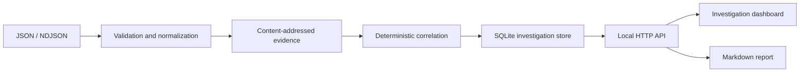

# IncidentLab

An evidence-grounded incident investigation workbench for GCP-format telemetry. Import evidence, correlate operational signals, inspect a chronological timeline, and export reports with citations to original records.

## Run

Python 3.9+ is the only requirement. From this directory:

```sh
python3 -m incidentlab
```

Open http://127.0.0.1:8080. Replay a scenario or import JSON / NDJSON. Investigations persist in `data/incidentlab.db`. Override defaults with `--port 8081` or `--db /path/to/incidentlab.db`. Stop with Ctrl+C.

No installation, account, credentials, cloud resources, model, paid API, or internet connection is required. All runtime assets are local. The server binds only to loopback.

## Workflow

1. Replay **Checkout deployment**, **Connection pressure**, or **Access regression**, or import a file.
2. Inspect findings. Click an evidence citation to open its raw record.
3. Review the timeline and filter the evidence index.
4. Export a Markdown report with evidence references and analysis limits.
5. Reopen the workbench to resume persisted investigations. Identical input reuses the same investigation.

## Evidence contract

Input is a JSON array or one JSON object per line. Maximum 5 MiB per HTTP request and 10,000 records per investigation. A batch fails atomically if any record is invalid.

Each record needs a timezone-qualified ISO timestamp and a `resource.labels.service_name`, `cluster_name`, or `database_id`. Cloud Audit Logs-style changes use `protoPayload.methodName`. Metrics use numeric `jsonPayload.error_rate` (percentage), `cpu_percent`, `connections_percent`, or `latency_ms`. This is the application's explicit ingestion contract. Arbitrary Cloud Monitoring API responses and Cloud Logging exports without these labels require transformation first. Complete examples are in `fixtures/`.

```json
{
  "timestamp": "2026-10-28T10:04:00Z",
  "severity": "ERROR",
  "resource": {
    "type": "cloud_run_revision",
    "labels": {"project_id": "incidentlab-local", "service_name": "checkout-api"}
  },
  "jsonPayload": {"message": "Request failures increased", "error_rate": 28.4, "latency_ms": 3100}
}
```

Canonical JSON produces SHA-256-derived evidence IDs. Duplicate records are removed and records are sorted by UTC time. Correlation is scoped to a service label within one investigation: submit different projects and environments as separate investigations.

## Rules

| Signal | Threshold | Result |
| --- | --- | --- |
| Request failures | Error rate ≥5% | Elevated failures; critical at ≥20% |
| Resource pressure | CPU or connections ≥90% | Resource saturation |
| Authorization errors | Explicit permission-denied text | Authorization failures |
| Nearby configuration change | Same service, 0–15 minutes before first signal | Change-related hypothesis |

Confidence is a heuristic, not a calibrated probability. A nearby change gives medium causal confidence; signals alone give low confidence. Temporal correlation is not proof of root cause. Recommended actions never execute remediation.

## Architecture



The backend uses Python's standard library and SQLite WAL. The browser interface has no dependencies. Analysis is a pure function, separate from transport and persistence. See [architecture notes](docs/architecture.md) for scaling boundaries and a future GCP mapping.

## API and tests

| Method | Route | Behavior |
| --- | --- | --- |
| GET | `/api/health` | Runtime health |
| GET | `/api/investigations` | Investigation summaries |
| POST | `/api/investigations` | Analyze and persist a JSON array |
| POST | `/api/scenarios` | Replay `{"name":"checkout"}`, `database`, or `iam` |
| GET | `/api/investigations/{id}` | Investigation with evidence |
| GET | `/api/investigations/{id}/report` | Markdown report |

```sh
curl -H 'Content-Type: application/json' --data-binary @fixtures/checkout.json http://127.0.0.1:8080/api/investigations
python3 -m unittest discover -s tests -v
```

## Operational boundaries

This release is a single-user local workbench. SQLite has one writer; analysis is synchronous and request-bounded. There is no distributed queue, high availability, authentication, live GCP connector, or production capacity claim. Do not expose the development server to a network. Evidence is stored as supplied: redact secrets before import and remove the local database when retention is no longer needed. The application never reads cloud credentials.

## Source map

- `incidentlab/engine.py`: validation, deduplication, correlation, reporting
- `incidentlab/store.py`: transactional persistence
- `incidentlab/server.py`: HTTP API and static assets
- `web/`: responsive interface
- `fixtures/`: three versioned evidence sets
- `tests/`: engine invariants and API integration tests
- `docs/architecture.md`: design decisions and scale roadmap
